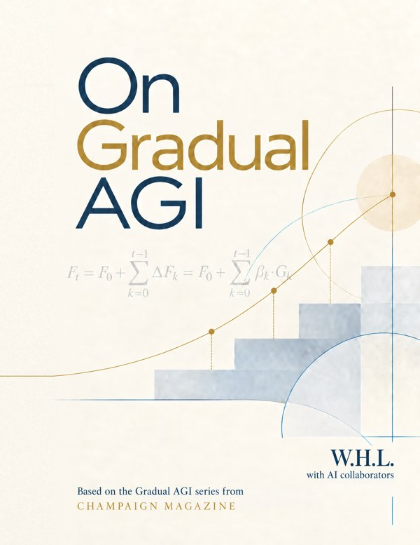

---
hide:
  - navigation
  - toc
---

# On Gradual AGI

**W.H.L.**
with GPT-6.1 Sol and Claude Opus 5.5

*Champaign Magazine* · First Edition, 2026

*On Gradual AGI* treats artificial general intelligence as a gradual, ongoing transformation rather than a single arrival. It sets out the Multi-Plateau Framework and the Unified Gradual AGI Model. The book follows how capability becomes realized change, and how optimization, governance, participation, evidence and feedback shape that path. The book distinguishes claim types, records the evidentiary standing of its principal claims, and specifies tests, limitations, and failure conditions where applicable.

**First Edition · Version 1.0.1 · October 2026**

[Start reading](reader-guide.md){ .md-button .md-button--primary }
[Download the PDF](https://github.com/champaignmagazine/on-gradual-agi/releases/download/v1.0.1/On_Gradual_AGI_v1.0.1.pdf){ .md-button }
[All formats (PDF, Word, figure)](https://github.com/champaignmagazine/on-gradual-agi/releases/latest){ .md-button }

## Contents

**Front matter:** [Copyright and License](copyright.md) · [Preface](preface.md) · [Contributors and AI Collaboration](contributors.md) · [About the Author](about-the-author.md) · [Notation Quick Reference](notation-quick-reference.md) · [Reader Guide](reader-guide.md)

**Part I. Orientation**

- [1 · AGI and the Meaning of Gradual Transformation](chapter-01.md)
- [2 · AGI-Inclusive Humanity](chapter-02.md)

**Part II. Architecture**

- [3 · A Multi-Plateau Framework of the Unified Gradual AGI Model](chapter-03.md)
- [4 · From Potential to Realization](chapter-04.md)
- [5 · Synchronization: Ceiling, Floor, and Slope](chapter-05.md)
- [6 · Optimization: Choosing Among Trajectories](chapter-06.md)

**Part III. Mediation**

- [7 · Governance: Contesting Realization](chapter-07.md)
- [8 · Participation: Subjects, Acts, and Consequences](chapter-08.md)
- [9 · Participation: What Survives Empirical Contact](chapter-09.md)
- [10 · Observation, Evidence, and Epistemic Discipline](chapter-10.md)
- [11 · Feedback, Recursion, and Ongoing Transformation](chapter-11.md)

**Part IV. Integration**

- [12 · The Unified Gradual AGI Model](chapter-12.md)

[Glossary](glossary.md) · [Full Notation Guide](notation-guide.md) · [Claims and Status Register](claims-and-status-register.md) · [Revision Record](revision-record.md) · [Unified References](references.md)

---

Licensed under [CC BY 4.0](https://creativecommons.org/licenses/by/4.0/). Source and PDF releases: [github.com/champaignmagazine/on-gradual-agi](https://github.com/champaignmagazine/on-gradual-agi).
